# SPSC vs MPSC fan-in: results

P producers -> 1 consumer on a 4-vCPU KVM guest (1 NUMA node, no PMU). Consumer pinned alone on cpu 0; producers round-robin on cpus 1-3. Two producer counts: **8** (oversubscribed, the original setup) and **3** (one producer per CPU). 30 interleaved rounds: each round runs every variant once in a shuffled order, each run its own process, so drift spreads evenly. Message counts are calibrated so each run takes ~1.5 s. All runs passed ordering/delivery/payload validation. Ratios below come with bootstrap 95% confidence intervals; a CI that contains 1.00 means no detectable difference.

**Disturbed runs excluded:** 29 of 1080 runs had the machine-speed canary more than 15% slower than the machine's fast state (1.329 ns/iter) both before and after the run, and are excluded (see section 13); every cell keeps at least 27 runs. Per-dot counts in the charts are therefore below 30 for some cells.

Pre-critique data (sequential batches, old harness) is kept in `data/spsc`, `data/mpsc_*`, `data/*_mutex`, `data/*_spin`; it is superseded by `data/v2`.

## Key comparisons (median throughput ratio, bootstrap 95% CI)

| comparison | 8 producers | 3 producers |
|---|---|---|
| SPSC: pinned vs unpinned | 2.02x [1.85, 2.23] faster | 1.03x [0.993, 1.09] no detectable difference |
| SPSC: aligned vs packed | 0.94x [0.908, 0.999] slower | 0.882x [0.832, 0.931] slower |
| MPSC aligned: b1 vs no pause | 0.737x [0.679, 0.783] slower | 0.791x [0.753, 0.837] slower |
| MPSC packed: b1 vs no pause | 1.02x [0.911, 1.09] no detectable difference | 1.03x [0.937, 1.08] no detectable difference |
| MPSC aligned: b2 vs no pause | 1.14x [1.05, 1.24] faster | 1.24x [1.19, 1.3] faster |
| MPSC packed: b2 vs no pause | 1.17x [1.07, 1.24] faster | 1.19x [1.1, 1.26] faster |
| MPSC no pause: aligned vs packed | 1.83x [1.68, 1.96] faster | 1.97x [1.82, 2.09] faster |
| SPSC topology: mutex vs lock-free | 0.00554x [0.00502, 0.00681] slower | 0.0937x [0.086, 0.096] slower |
| SPSC topology: spin vs lock-free | 4.49e-05x [3.45e-05, 0.000668] slower | 0.0566x [0.0513, 0.0605] slower |
| SPSC topology: condvar vs lock-free | 0.11x [0.107, 0.114] slower | 0.255x [0.244, 0.262] slower |
| MPSC topology: mutex vs lock-free | 0.419x [0.392, 0.447] slower | 0.285x [0.271, 0.3] slower |
| MPSC topology: spin vs lock-free | 0.107x [0.0933, 0.132] slower | 0.124x [0.114, 0.149] slower |
| MPSC topology: condvar vs lock-free | 0.261x [0.239, 0.276] slower | 0.361x [0.349, 0.37] slower |
| Shared queue: lock-free MPSC vs SPSC fan-in | 0.387x [0.364, 0.415] slower | 0.807x [0.771, 0.836] slower |

## 1. SPSC: pinning and alignment

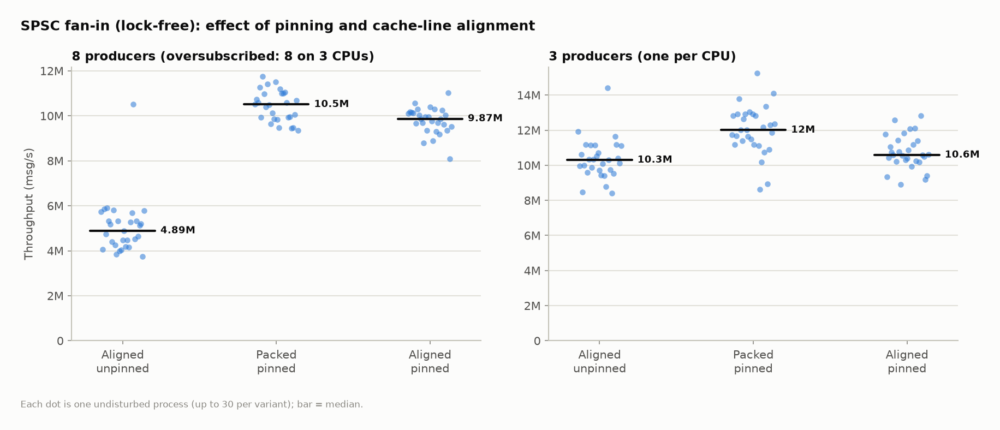

## 2. MPSC: no pause vs _mm_pause vs exponential backoff

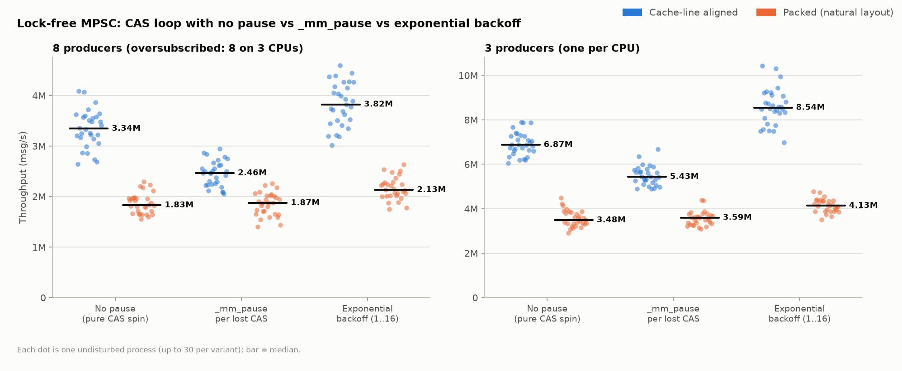

## 3. MPSC: lost CAS races

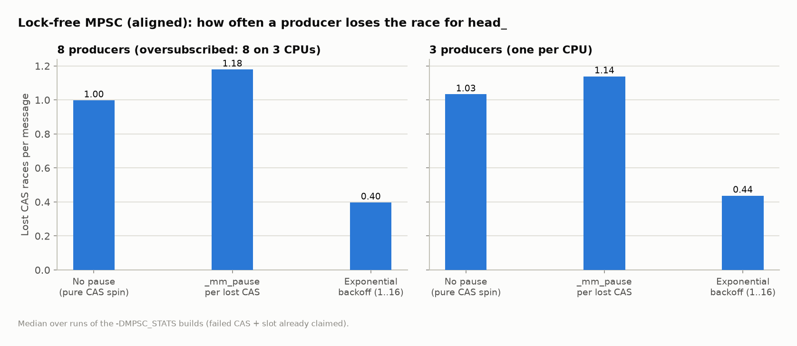

## 4. Wasted spin work

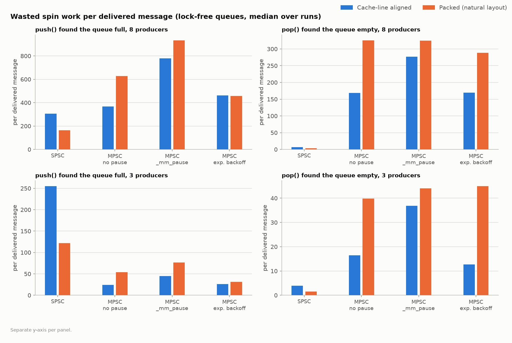

## 5. Overview

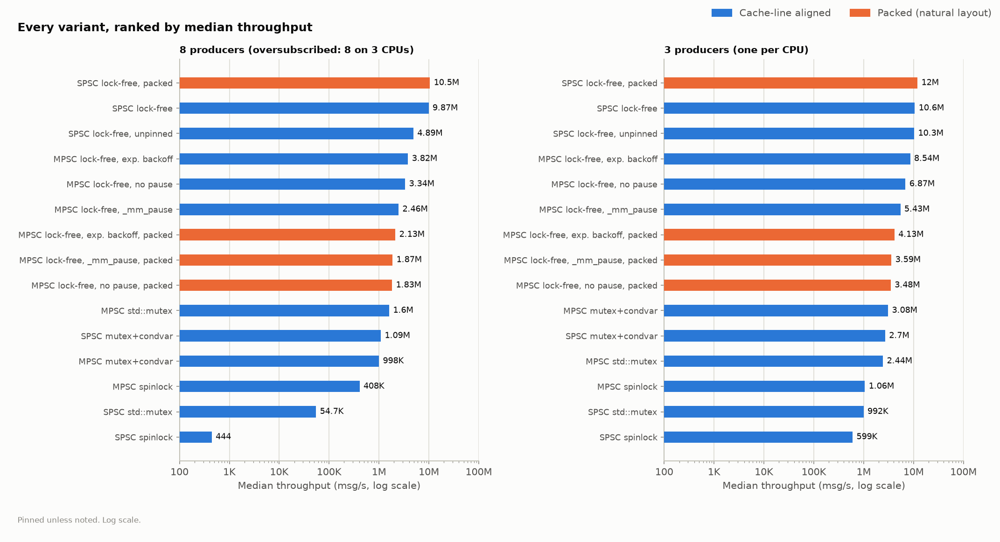

| variant | producers | runs kept | excluded | msgs/producer | min | median | max | full spins/msg | empty polls/msg | lost CAS/msg | futex/msg | ctx sw/msg |
|---|---|---|---|---|---|---|---|---|---|---|---|---|
| condvar_mpsc | 8 | 29 | 1 | 185585 | 901,322 | 998,027 | 1,160,890 | 0 | 0.377 | 0 | 2.07 | 0.466 |
| condvar_mpsc | 3 | 28 | 2 | 1525260 | 2,916,943 | 3,080,819 | 3,312,799 | 0 | 0.557 | 0 | 0.645 | 0.072 |
| condvar_spsc | 8 | 30 | 0 | 197027 | 970,753 | 1,089,298 | 1,313,793 | 0 | 0.879 | 0 | 1.76 | 0.52 |
| condvar_spsc | 3 | 28 | 2 | 1350741 | 2,497,641 | 2,697,094 | 2,960,619 | 0 | 2.82 | 0 | 0.686 | 0.111 |
| lockfree_mpsc_b0 | 8 | 30 | 0 | 704784 | 2,640,660 | 3,343,396 | 4,087,745 | 368 | 169 | 0 | 8.87e-07 | 0.000805 |
| lockfree_mpsc_b0 | 3 | 30 | 0 | 2000000 | 6,056,495 | 6,872,342 | 7,893,408 | 24 | 16.5 | 0 | 6.67e-07 | 0.000419 |
| lockfree_mpsc_b0_packed | 8 | 30 | 0 | 373348 | 1,552,498 | 1,828,488 | 2,298,634 | 627 | 326 | 0 | 1.67e-06 | 0.00152 |
| lockfree_mpsc_b0_packed | 3 | 29 | 1 | 1607798 | 2,912,741 | 3,483,995 | 4,496,078 | 53.7 | 39.8 | 0 | 8.29e-07 | 0.000802 |
| lockfree_mpsc_b0_stats | 8 | 29 | 1 | 751215 | 2,802,501 | 3,413,255 | 4,819,713 | 495 | 160 | 0.998 | 8.32e-07 | 0.000861 |
| lockfree_mpsc_b0_stats | 3 | 30 | 0 | 2000000 | 5,543,405 | 6,906,198 | 9,708,244 | 31 | 14.9 | 1.03 | 6.67e-07 | 0.0004 |
| lockfree_mpsc_b1 | 8 | 30 | 0 | 499730 | 2,049,984 | 2,464,622 | 2,950,025 | 778 | 277 | 0 | 1.25e-06 | 0.00108 |
| lockfree_mpsc_b1 | 3 | 29 | 1 | 2000000 | 4,885,219 | 5,434,177 | 6,669,634 | 44.9 | 36.9 | 0 | 6.67e-07 | 0.000543 |
| lockfree_mpsc_b1_packed | 8 | 29 | 1 | 355524 | 1,405,006 | 1,871,513 | 2,256,132 | 933 | 325 | 0 | 1.76e-06 | 0.00148 |
| lockfree_mpsc_b1_packed | 3 | 29 | 1 | 1778144 | 3,080,161 | 3,594,842 | 4,377,938 | 76.4 | 44.1 | 0 | 7.5e-07 | 0.000846 |
| lockfree_mpsc_b1_stats | 8 | 30 | 0 | 531005 | 1,896,839 | 2,302,562 | 2,922,013 | 868 | 308 | 1.18 | 1.18e-06 | 0.00122 |
| lockfree_mpsc_b1_stats | 3 | 29 | 1 | 2000000 | 4,519,528 | 5,398,764 | 6,679,842 | 44.7 | 40.6 | 1.14 | 6.67e-07 | 0.000518 |
| lockfree_mpsc_b2 | 8 | 29 | 1 | 658300 | 3,021,199 | 3,821,727 | 4,593,937 | 462 | 170 | 0 | 9.49e-07 | 0.000711 |
| lockfree_mpsc_b2 | 3 | 30 | 0 | 2000000 | 6,975,146 | 8,544,704 | 10,432,630 | 26.1 | 12.7 | 0 | 6.67e-07 | 0.000311 |
| lockfree_mpsc_b2_packed | 8 | 29 | 1 | 332267 | 1,753,575 | 2,130,874 | 2,630,171 | 456 | 288 | 0 | 1.88e-06 | 0.00136 |
| lockfree_mpsc_b2_packed | 3 | 29 | 1 | 1836776 | 3,522,969 | 4,134,238 | 4,776,959 | 31.6 | 44.9 | 0 | 7.26e-07 | 0.000667 |
| lockfree_mpsc_b2_stats | 8 | 28 | 2 | 747853 | 3,171,182 | 3,913,062 | 7,712,173 | 434 | 162 | 0.397 | 8.36e-07 | 0.000788 |
| lockfree_mpsc_b2_stats | 3 | 29 | 1 | 2000000 | 7,312,495 | 8,841,763 | 10,979,490 | 23 | 12.7 | 0.437 | 6.67e-07 | 0.0003 |
| lockfree_spsc | 8 | 29 | 1 | 2000000 | 8,093,599 | 9,872,304 | 11,030,166 | 305 | 7.07 | 0 | 3.13e-07 | 0.00028 |
| lockfree_spsc | 3 | 29 | 1 | 2000000 | 8,909,867 | 10,585,048 | 12,832,905 | 255 | 3.94 | 0 | 6.67e-07 | 0.000263 |
| lockfree_spsc_packed | 8 | 28 | 2 | 1823108 | 9,362,131 | 10,504,639 | 11,760,132 | 163 | 3.42 | 0 | 2.74e-07 | 0.000264 |
| lockfree_spsc_packed | 3 | 30 | 0 | 2000000 | 8,623,857 | 12,005,163 | 15,245,755 | 122 | 1.57 | 0 | 6.67e-07 | 0.000237 |
| lockfree_spsc_unpinned | 8 | 29 | 1 | 820552 | 3,739,071 | 4,889,251 | 10,509,269 | 1.14e+03 | 7.73 | 0 | 4.57e-07 | 0.000553 |
| lockfree_spsc_unpinned | 3 | 29 | 1 | 2000000 | 8,407,059 | 10,296,355 | 14,421,955 | 277 | 3.91 | 0 | 3.33e-07 | 0.000291 |
| mutex_mpsc | 8 | 30 | 0 | 302608 | 1,406,437 | 1,602,322 | 1,959,375 | 4.8 | 0.193 | 0 | 1.6 | 0.112 |
| mutex_mpsc | 3 | 29 | 1 | 1323835 | 2,241,174 | 2,435,676 | 2,827,116 | 2.35 | 0.167 | 0 | 1.16 | 0.0674 |
| mutex_spsc | 8 | 30 | 0 | 10079 | 37,011 | 54,656 | 180,187 | 2.86e+03 | 2.02 | 0 | 2.61 | 0.0416 |
| mutex_spsc | 3 | 27 | 3 | 549657 | 857,204 | 992,070 | 1,097,077 | 84.9 | 0.186 | 0 | 2.46 | 0.00393 |
| spin_mpsc | 8 | 30 | 0 | 96452 | 220,212 | 407,830 | 1,403,277 | 5.2 | 0.138 | 0 | 6.48e-06 | 0.00717 |
| spin_mpsc | 3 | 28 | 2 | 679674 | 666,786 | 1,055,293 | 1,977,919 | 4.41 | 0.193 | 0 | 1.96e-06 | 0.00287 |
| spin_spsc | 8 | 30 | 0 | 200 | 296 | 444 | 1,082,768 | 6.45e+05 | 1.98 | 0 | 0.00313 | 6.95 |
| spin_spsc | 3 | 30 | 0 | 343505 | 381,785 | 599,156 | 906,430 | 314 | 0.0124 | 0 | 3.88e-06 | 0.00476 |

## 6. Valgrind cachegrind

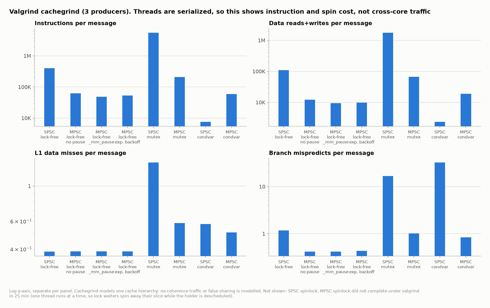

`--cache-sim=yes --branch-sim=yes --fair-sched=yes`, 3 producers. Valgrind runs one thread at a time and models one cache, so it cannot see coherence traffic or false sharing.

| variant | msgs | instr/msg | data refs/msg | D1 misses | LLd misses | branches/msg | mispredicts |
|---|---|---|---|---|---|---|---|
| spin_spsc | did not complete under valgrind (25 min timeout) | | | | | | |
| spin_mpsc | did not complete under valgrind (25 min timeout) | | | | | | |
| lockfree_spsc | 60,000 | 397,331 | 108,376 | 23,104 | 11,311 | 59,771 | 70,007 |
| lockfree_mpsc_b0 | 60,000 | 62,374 | 12,205 | 23,203 | 11,368 | 12,179 | 24,915 |
| lockfree_mpsc_b1 | 60,000 | 48,673 | 9,458 | 23,202 | 11,368 | 9,442 | 24,926 |
| lockfree_mpsc_b2 | 60,000 | 52,990 | 9,681 | 23,202 | 11,368 | 9,665 | 25,870 |
| mutex_spsc | 16,488 | 5,545,454 | 1,768,172 | 23,222 | 11,342 | 1,125,264 | 274,173 |
| mutex_mpsc | 39,714 | 207,640 | 66,212 | 23,208 | 11,329 | 42,910 | 40,346 |
| condvar_spsc | 40,521 | 7,563 | 2,349 | 23,330 | 11,379 | 1,544 | 1,314,182 |
| condvar_mpsc | 45,756 | 58,938 | 18,829 | 23,303 | 11,365 | 12,805 | 38,127 |

## 7. Lock-free vs lock-based queues

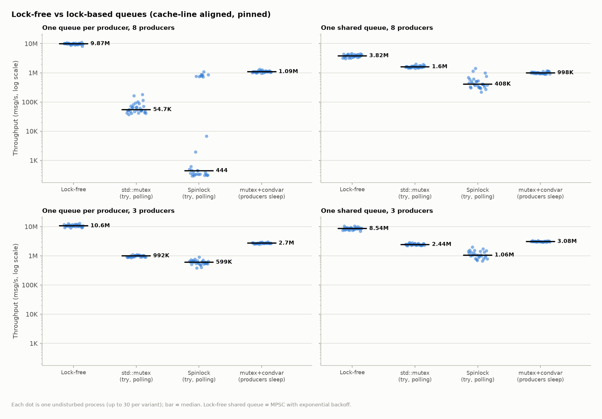

## 8. std::mutex under low vs high contention (futex)

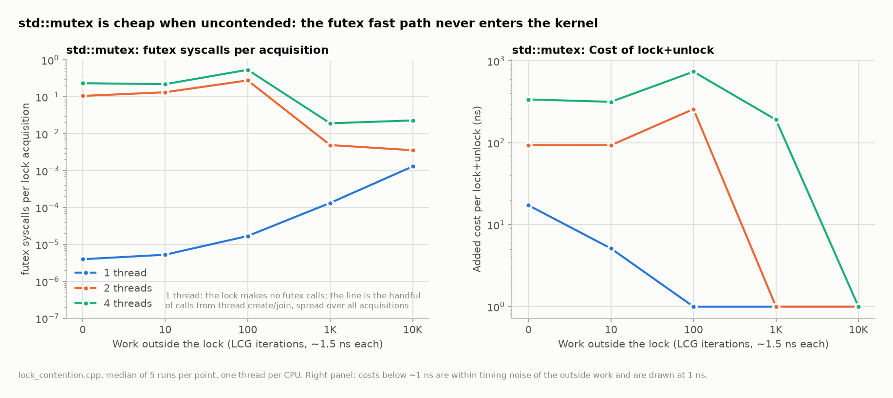

`lock_contention.cpp`: threads lock, bump a shared counter, unlock, then do private work. Added cost = (time with lock - same loop without) / ops. futex counted with `perf stat -e syscalls:sys_enter_futex`.

| lock | threads | work outside lock | futex/acquire | added ns per lock+unlock |
|---|---|---|---|---|
| mutex | 1 | 0 | 0.000004 | 17.3 |
| mutex | 1 | 10 | 0.000005 | 5.1 |
| mutex | 1 | 100 | 0.000017 | 0.4 |
| mutex | 1 | 1000 | 0.000134 | -4.4 |
| mutex | 1 | 10000 | 0.001304 | -274.8 |
| mutex | 2 | 0 | 0.106001 | 93.8 |
| mutex | 2 | 10 | 0.133086 | 93.5 |
| mutex | 2 | 100 | 0.279121 | 258.2 |
| mutex | 2 | 1000 | 0.004941 | -3.5 |
| mutex | 2 | 10000 | 0.003587 | -1183.2 |
| mutex | 4 | 0 | 0.234293 | 339.1 |
| mutex | 4 | 10 | 0.220641 | 316.8 |
| mutex | 4 | 100 | 0.539990 | 739.5 |
| mutex | 4 | 1000 | 0.019204 | 191.4 |
| mutex | 4 | 10000 | 0.022987 | -490.5 |
| spin | 1 | 0 | 0.000004 | 8.0 |
| spin | 1 | 10 | 0.000005 | -0.1 |
| spin | 1 | 100 | 0.000017 | -17.8 |
| spin | 1 | 1000 | 0.000134 | -8.2 |
| spin | 1 | 10000 | 0.001304 | -311.0 |
| spin | 2 | 0 | 0.000003 | 96.5 |
| spin | 2 | 10 | 0.000003 | 91.2 |
| spin | 2 | 100 | 0.000013 | 96.0 |
| spin | 2 | 1000 | 0.000067 | -1.8 |
| spin | 2 | 10000 | 0.000815 | -197.8 |
| spin | 4 | 0 | 0.000001 | 332.6 |
| spin | 4 | 10 | 0.000002 | 379.5 |
| spin | 4 | 100 | 0.000006 | 476.6 |
| spin | 4 | 1000 | 0.000050 | 56.3 |
| spin | 4 | 10000 | 0.000489 | 5626.3 |

## 9. Mutex vs spinlock at maximum contention

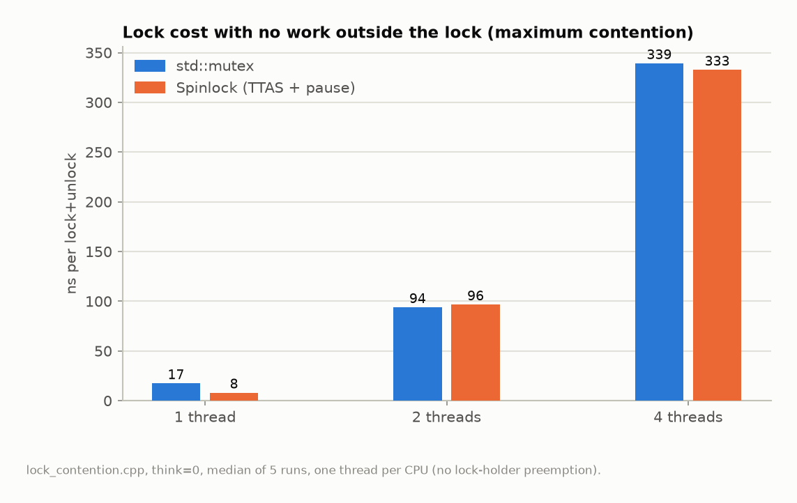

## 10. Kernel involvement per message

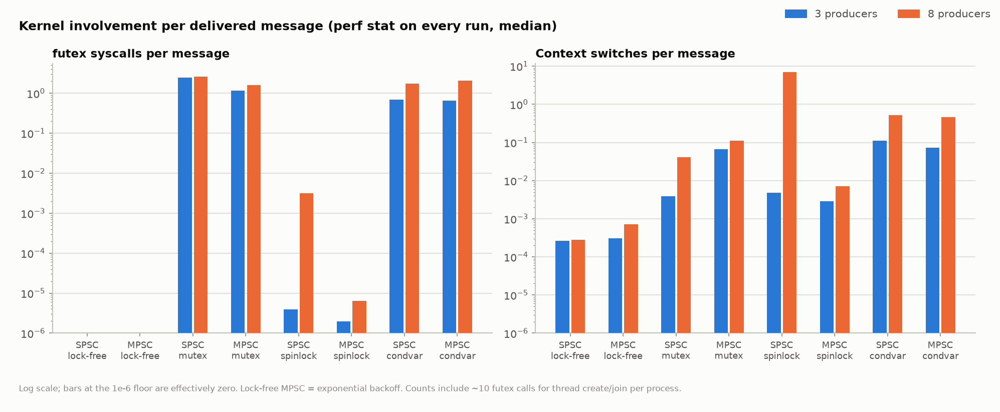

## 11. Flamegraphs

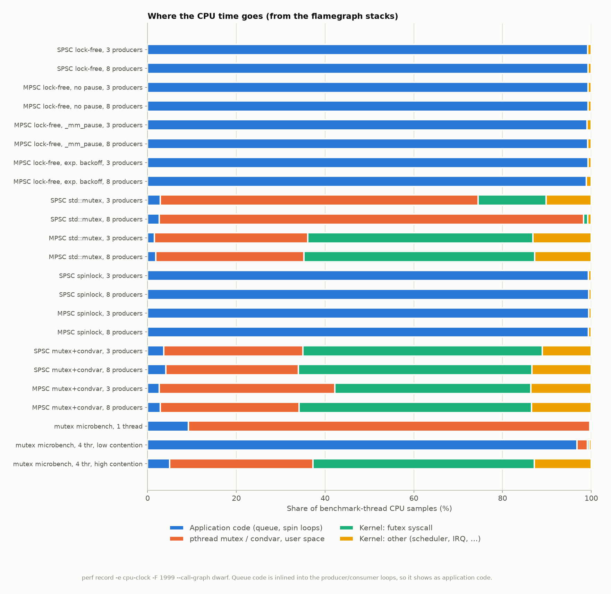

Interactive SVGs (open in a browser; click to zoom):

- [SPSC lock-free, 3 producers](flamegraphs/lockfree_spsc_p3.svg)
- [SPSC lock-free, 8 producers](flamegraphs/lockfree_spsc_p8.svg)
- [MPSC lock-free, no pause, 3 producers](flamegraphs/lockfree_mpsc_b0_p3.svg)
- [MPSC lock-free, no pause, 8 producers](flamegraphs/lockfree_mpsc_b0_p8.svg)
- [MPSC lock-free, _mm_pause, 3 producers](flamegraphs/lockfree_mpsc_b1_p3.svg)
- [MPSC lock-free, _mm_pause, 8 producers](flamegraphs/lockfree_mpsc_b1_p8.svg)
- [MPSC lock-free, exp. backoff, 3 producers](flamegraphs/lockfree_mpsc_b2_p3.svg)
- [MPSC lock-free, exp. backoff, 8 producers](flamegraphs/lockfree_mpsc_b2_p8.svg)
- [SPSC std::mutex, 3 producers](flamegraphs/mutex_spsc_p3.svg)
- [SPSC std::mutex, 8 producers](flamegraphs/mutex_spsc_p8.svg)
- [MPSC std::mutex, 3 producers](flamegraphs/mutex_mpsc_p3.svg)
- [MPSC std::mutex, 8 producers](flamegraphs/mutex_mpsc_p8.svg)
- [SPSC spinlock, 3 producers](flamegraphs/spin_spsc_p3.svg)
- [SPSC spinlock, 8 producers](flamegraphs/spin_spsc_p8.svg)
- [MPSC spinlock, 3 producers](flamegraphs/spin_mpsc_p3.svg)
- [MPSC spinlock, 8 producers](flamegraphs/spin_mpsc_p8.svg)
- [SPSC mutex+condvar, 3 producers](flamegraphs/condvar_spsc_p3.svg)
- [SPSC mutex+condvar, 8 producers](flamegraphs/condvar_spsc_p8.svg)
- [MPSC mutex+condvar, 3 producers](flamegraphs/condvar_mpsc_p3.svg)
- [MPSC mutex+condvar, 8 producers](flamegraphs/condvar_mpsc_p8.svg)
- [mutex microbench, 1 thread](flamegraphs/mutex_uncontended.svg)
- [mutex microbench, 4 thr, low contention](flamegraphs/mutex_low_contention.svg)
- [mutex microbench, 4 thr, high contention](flamegraphs/mutex_high_contention.svg)

| profile | Application code (queue, spin loops) | pthread mutex / condvar, user space | Kernel: futex syscall | Kernel: other (scheduler, IRQ, ...) |
|---|---|---|---|---|
| SPSC lock-free, 3 producers | 99.2% | 0.0% | 0.0% | 0.8% |
| SPSC lock-free, 8 producers | 99.3% | 0.0% | 0.0% | 0.7% |
| MPSC lock-free, no pause, 3 producers | 99.3% | 0.0% | 0.0% | 0.7% |
| MPSC lock-free, no pause, 8 producers | 99.3% | 0.0% | 0.0% | 0.7% |
| MPSC lock-free, _mm_pause, 3 producers | 99.1% | 0.0% | 0.0% | 0.9% |
| MPSC lock-free, _mm_pause, 8 producers | 99.2% | 0.0% | 0.0% | 0.8% |
| MPSC lock-free, exp. backoff, 3 producers | 99.3% | 0.0% | 0.0% | 0.7% |
| MPSC lock-free, exp. backoff, 8 producers | 98.9% | 0.0% | 0.0% | 1.1% |
| SPSC std::mutex, 3 producers | 2.8% | 71.7% | 15.3% | 10.2% |
| SPSC std::mutex, 8 producers | 2.6% | 95.7% | 0.9% | 0.8% |
| MPSC std::mutex, 3 producers | 1.6% | 34.5% | 50.8% | 13.1% |
| MPSC std::mutex, 8 producers | 1.9% | 33.4% | 52.0% | 12.7% |
| SPSC spinlock, 3 producers | 99.4% | 0.0% | 0.0% | 0.6% |
| SPSC spinlock, 8 producers | 99.4% | 0.0% | 0.0% | 0.6% |
| MPSC spinlock, 3 producers | 99.4% | 0.0% | 0.0% | 0.6% |
| MPSC spinlock, 8 producers | 99.3% | 0.0% | 0.0% | 0.7% |
| SPSC mutex+condvar, 3 producers | 3.6% | 31.4% | 54.0% | 11.0% |
| SPSC mutex+condvar, 8 producers | 4.1% | 29.9% | 52.6% | 13.3% |
| MPSC mutex+condvar, 3 producers | 2.6% | 39.6% | 44.2% | 13.6% |
| MPSC mutex+condvar, 8 producers | 2.9% | 31.3% | 52.4% | 13.5% |
| mutex microbench, 1 thread | 9.2% | 90.4% | 0.0% | 0.4% |
| mutex microbench, 4 thr, low contention | 96.8% | 2.4% | 0.3% | 0.5% |
| mutex microbench, 4 thr, high contention | 5.0% | 32.3% | 49.8% | 12.9% |

## 12. Oversubscription

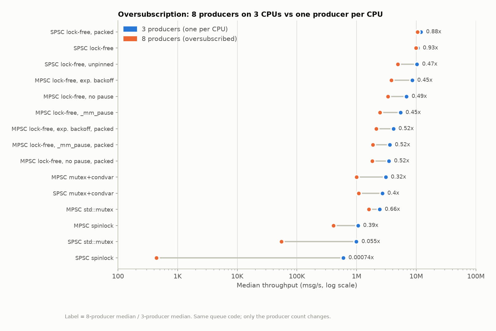

## 13. Machine speed and excluded runs

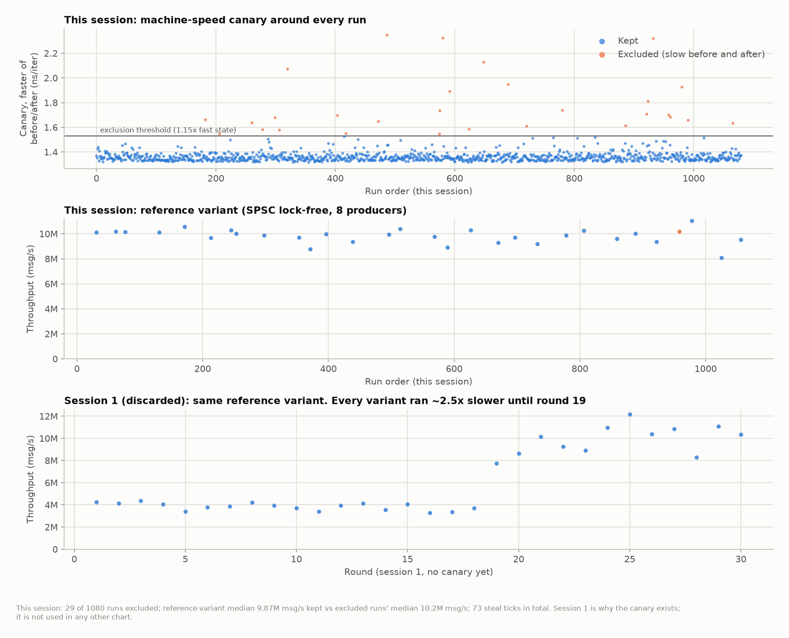
