# SPSC versus MPSC: VM rerun

All **1,080 equal-capacity runs** passed delivery, sequence, payload and drain validation. The two primary configurations have equal total capacity and equal messages within each SPSC/MPSC pair. Hardware performance counters and kernel isolation are unavailable on this VM; no hardware counts or isolation improvement are claimed.

## Main measurements

| Queue | Four producers, 32 total slots | Eight producers, 64 total slots |
|---|---:|---:|
| lockfree_spsc | 14.731 M msg/s | 15.781 M msg/s |
| lockfree_mpsc_b0 | 7.029 M msg/s | 4.318 M msg/s |
| lockfree_mpsc_b1 | 5.955 M msg/s | 3.588 M msg/s |
| lockfree_mpsc_b2 | 9.435 M msg/s | 4.765 M msg/s |
| mutex_spsc | 1.351 M msg/s | 0.625 M msg/s |
| mutex_mpsc | 1.322 M msg/s | 0.852 M msg/s |
| spin_spsc | 0.868 M msg/s | 0.238 M msg/s |
| spin_mpsc | 1.318 M msg/s | 0.845 M msg/s |
| condvar_spsc | 0.308 M msg/s | 0.165 M msg/s |
| condvar_mpsc | 0.070 M msg/s | 0.080 M msg/s |

SPSC fan-in is faster in these balanced atomic-queue workloads. It also has weaker aggregate ordering and partitioned capacity, so this is not a universal ranking of interchangeable APIs. See [code/harness review](../../REVIEW.md).

## Ratio uncertainty

Paired-round bootstrap of the ratio of medians; 10,000 resamples, 95% interval. These are within-session intervals, not bounds on results across different machines. A ratio above 1 favors the numerator.

| Producers | Numerator / denominator | Ratio | 95% interval |
|---:|---|---:|---:|
| 4 | lockfree_mpsc_b0 / lockfree_spsc | 0.477× | 0.398–0.515× |
| 4 | lockfree_mpsc_b1 / lockfree_spsc | 0.404× | 0.340–0.438× |
| 4 | lockfree_mpsc_b2 / lockfree_spsc | 0.641× | 0.563–0.692× |
| 4 | lockfree_mpsc_b2 / lockfree_mpsc_b0 | 1.342× | 1.227–1.500× |
| 4 | lockfree_spsc / lockfree_spsc_unpinned | 1.101× | 1.012–1.337× |
| 4 | lockfree_spsc / lockfree_spsc_packed | 0.878× | 0.808–1.006× |
| 8 | lockfree_mpsc_b0 / lockfree_spsc | 0.274× | 0.261–0.294× |
| 8 | lockfree_mpsc_b1 / lockfree_spsc | 0.227× | 0.212–0.245× |
| 8 | lockfree_mpsc_b2 / lockfree_spsc | 0.302× | 0.286–0.336× |
| 8 | lockfree_mpsc_b2 / lockfree_mpsc_b0 | 1.104× | 1.036–1.197× |
| 8 | lockfree_spsc / lockfree_spsc_unpinned | 1.125× | 1.048–1.176× |
| 8 | lockfree_spsc / lockfree_spsc_packed | 0.915× | 0.815–1.019× |

## Run design and limits

- GCC 13.3, C++20, `-O3 -g -fno-omit-frame-pointer -Wall -Wextra -Werror -pthread`. The original results used a different VM and Clang; cross-host differences are not optimization effects.
- KVM exposes nine vCPUs and an eight-CPU cgroup quota. Consumer CPU 0 is separate from all producers. Four producers use 1–4; eight producers round-robin over 1–7. The controller uses CPU 8 in pinned runs. No CPU is exclusively owned or isolated from OS/hypervisor work.
- SPSC capacity is eight per producer; shared capacity is 32 at four producers and 64 at eight. Payload is one 64-bit word. Thirty shuffled rounds use 100,000 messages/producer for atomic queues, 10,000 for lock-based queues. Fixed work within each strategy/topology pair; cross-strategy comparisons have different run durations.
- The start barrier excludes creation and pinning; the consumer ends timing after the final validated message. Queue validation remains in the measured region. There is no separate steady-state warmup or latency distribution.
- All runs retained. Canary readings and steal/throttling deltas are diagnostic only. The containing cgroup may include other work. One shared producer CPU remains in the eight-producer primary condition.
- Statistical comparisons are exploratory: no multiple-comparison correction. Small effects and short-run rankings require confirmation.

149 / 1080 primary runs observed a cgroup throttling increment. The observation window includes canary/control work. No filtered subset replaces the main result.

## Original matrix rerun

1080 measured runs reproduce the original 18 variants × 3/8 producers × 30 shuffled rounds on CPUs 0–3. Capacities remain 8 per SPSC queue versus 64 shared. The rerun uses a 0.2-second calibration target (50-ms probe threshold, 200–200,000 messages/producer), versus the archived 1.5-second target and larger cap. This is the same test matrix with shorter run lengths, not a bit-for-bit replication. The first oversubscribed SPSC-spinlock calibration timed out at 120 seconds; that cell is capped at the original minimum of 200 messages per producer. The timeout log is retained. Separate files preserve original v2 results and original sources. The 3-producer legacy case does not have equal total capacity.

Legacy [raw runs](../../data/v3/legacy_runs.csv); primary [raw runs](../../data/v3/fair_runs.csv); [all per-variant summary statistics](summary.csv). Legacy-vs-primary changes include scheduling and run length and are not an isolated causal estimate of CPU placement.

## Correctness

90/90 ThreadSanitizer cases and 90/90 ASan+UBSan cases passed. Leak detection was disabled only because this process namespace prevents LeakSanitizer from examining threads; leak checking is not claimed. The relaxed-publication mutation failed as expected with a TSan data race (exit 66). Three affinity regression checks passed. Every native throughput row passed validation. Logs and machine-readable results are under [data/v3/tests](../../data/v3/tests/).

## Counter and isolation status

| Measurement/control | Result |
|---|---|
| Cycles, instructions, cache references/misses, branches/misses | Hardware event probes return ENOENT; perf says not supported; no guest CPU PMU |
| Software task-clock / page faults | Collected with user-only perf requests; process-wide |
| Context switches | Collected with wait4; voluntary + involuntary; process-wide |
| perf context switches / migrations | User-only requests return misleading zeros; raw values retained but not interpreted |
| Futex syscall tracing | Tracefs unavailable; strace ptrace attempt denied |
| Sampled flamegraphs | perf record cpu-clock:u and --all-user denied; no fresh flamegraphs |
| CPU affinity | Applied and verified |
| isolcpus / nohz_full / RCU offload / IRQ routing | Not changed; read-only control files and no effective administrative capabilities |
| Improvement from kernel isolation | Unmeasured (N/A) |

RCU should remain enabled; the relevant tuning is callback offload. Eligible device IRQs are redirected, rather than disabling all interrupts. See the [host-isolation procedure](../../ISOLATION.md).

## Longer-run confirmation

80 runs use 1,000,000 messages per producer for all four atomic strategies and both producer counts, in ten shuffled rounds. Every row passed.

| Producers | SPSC M msg/s | MPSC backoff M msg/s | MPSC / SPSC |
|---:|---:|---:|---:|
| 4 | 14.527 | 8.992 | 0.619× |
| 8 | 15.665 | 5.844 | 0.373× |

[Longer-run raw data](../../data/v3/long_confirmation.csv).

## Profiling completion

| Variant | Cachegrind status | Messages |
|---|---|---:|
| lockfree_spsc | complete | 3000 |
| lockfree_mpsc_b0 | complete | 3000 |
| lockfree_mpsc_b1 | complete | 3000 |
| lockfree_mpsc_b2 | complete | 3000 |
| mutex_spsc | complete | 3000 |
| mutex_mpsc | complete | 3000 |
| spin_spsc | timeout | 3000 |
| spin_mpsc | timeout | 3000 |
| condvar_spsc | complete | 3000 |
| condvar_mpsc | complete | 3000 |

Cachegrind uses the original three-producer topology, fixed 1,000 messages/producer, 60-second timeout per process. Simulation is serialized and does not model cross-core cache-coherence traffic. Its counts are not hardware measurements. It includes startup costs; shorter samples differ from the archived profile workloads. Raw simulator output and errors are retained.

## Charts

### 01 spsc alignment pinning
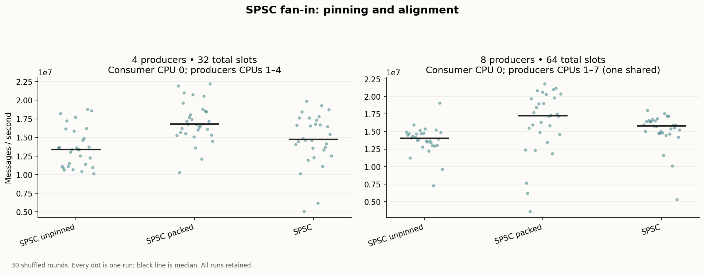

### 02 mpsc backoff throughput
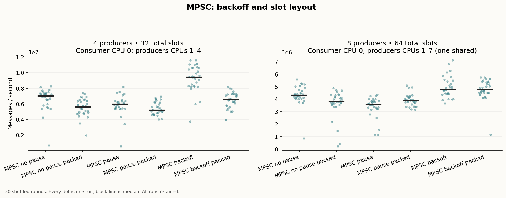

### 03 mpsc cas retries
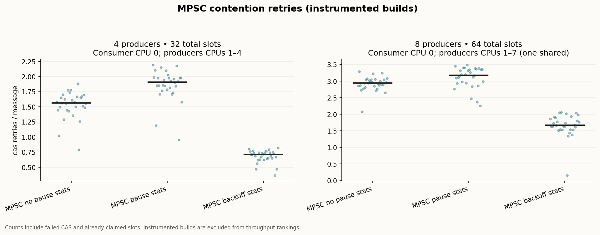

### 04 spin waste
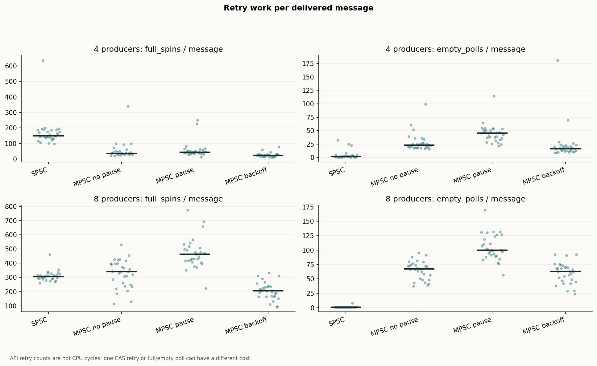

### 05 overview ranking
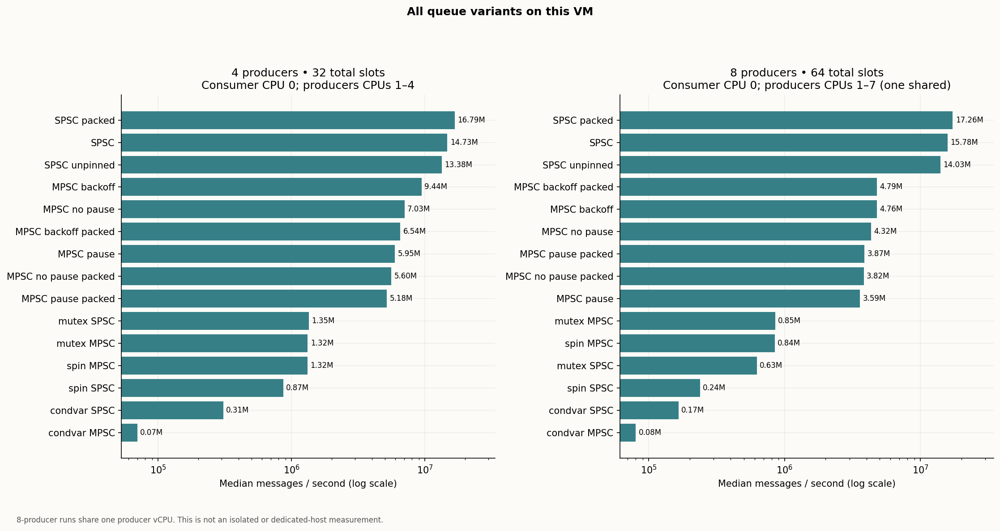

### 06 valgrind cachegrind
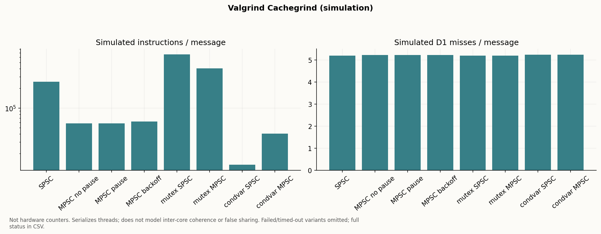

### 07 lockfree vs locks
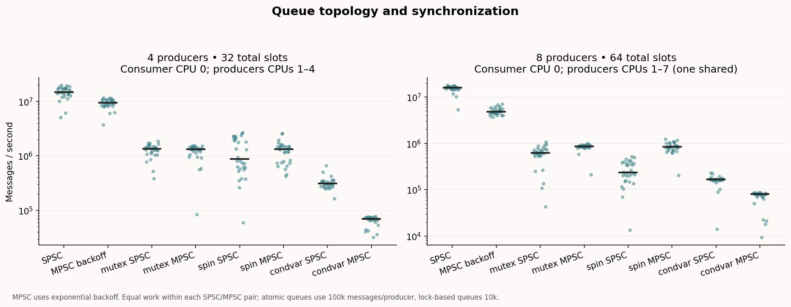

### 08 mutex contention futex
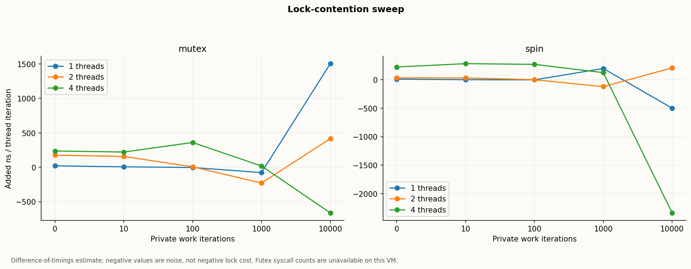

### 09 mutex vs spin max contention
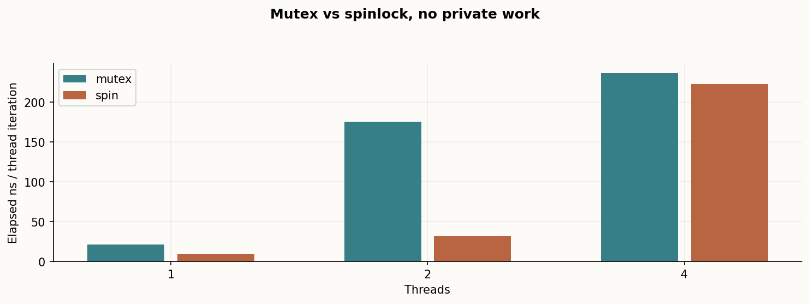

### 10 queue syscalls
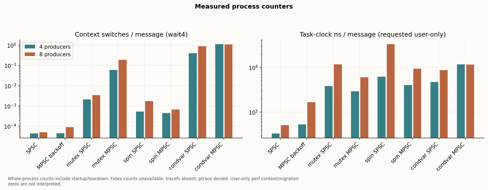

### 11 flamegraph breakdown
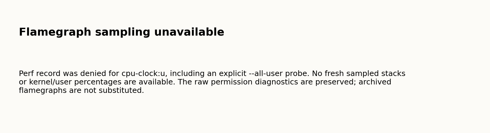

### 12 oversubscription
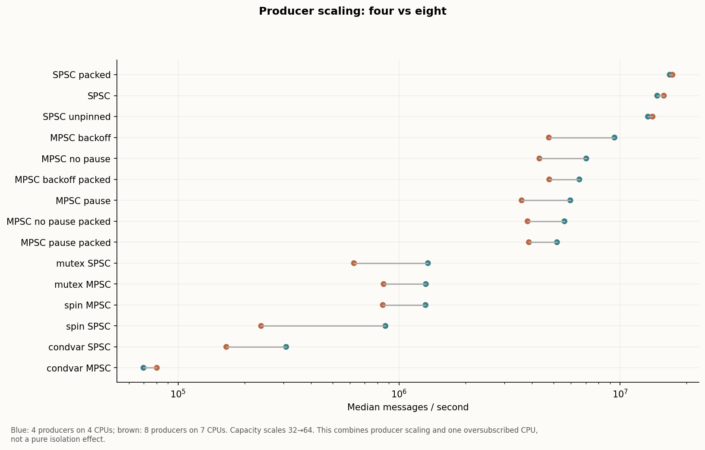

### 13 machine speed
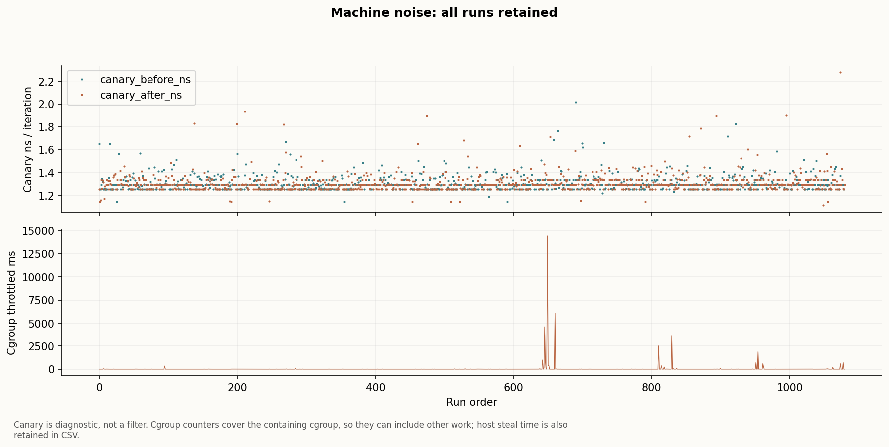

### 14 capacity fairness

### 15 isolation status
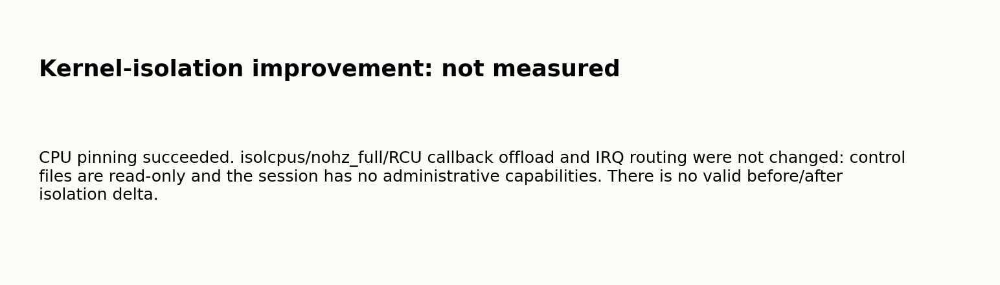

